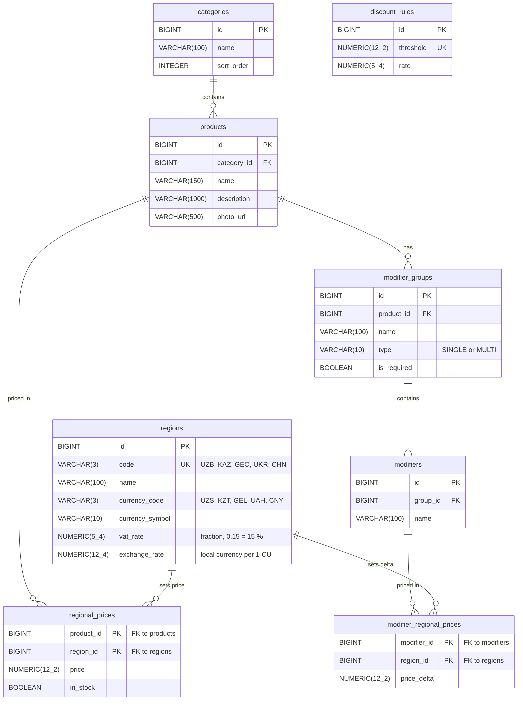

# Catalog ER diagram (V1)

Migration: `src/main/resources/db/migration/V1__catalog.sql`.

## Rules

- Money is `NUMERIC(12,2)`, rates are `NUMERIC(5,4)` stored as a fraction.
- `price`, `price_delta` and `threshold` are stored in conventional units (CU). `regions.exchange_rate` is how much local currency one CU is worth, for example 3000 for UZB (1 CU = 3000 UZS). It must be greater than 0.
- The calculator converts prices to the local currency first (`price × exchange_rate`), then runs the formula from the spec. It compares `amountInclVat` with `threshold × exchange_rate`. All amounts in the API are in the local currency, so the frontend never recalculates them.
- A product has one price per region. `in_stock` is set per region too, so a product can be sold out in one country only.
- A modifier adds `price_delta` per unit, in CU.
- `discount_rules` is one table for every region. The calculator picks the highest converted `threshold` that `amountInclVat` reaches.
- Deleting a product removes its prices, modifier groups, modifiers and modifier prices. Regions and categories that are still referenced can't be deleted.
